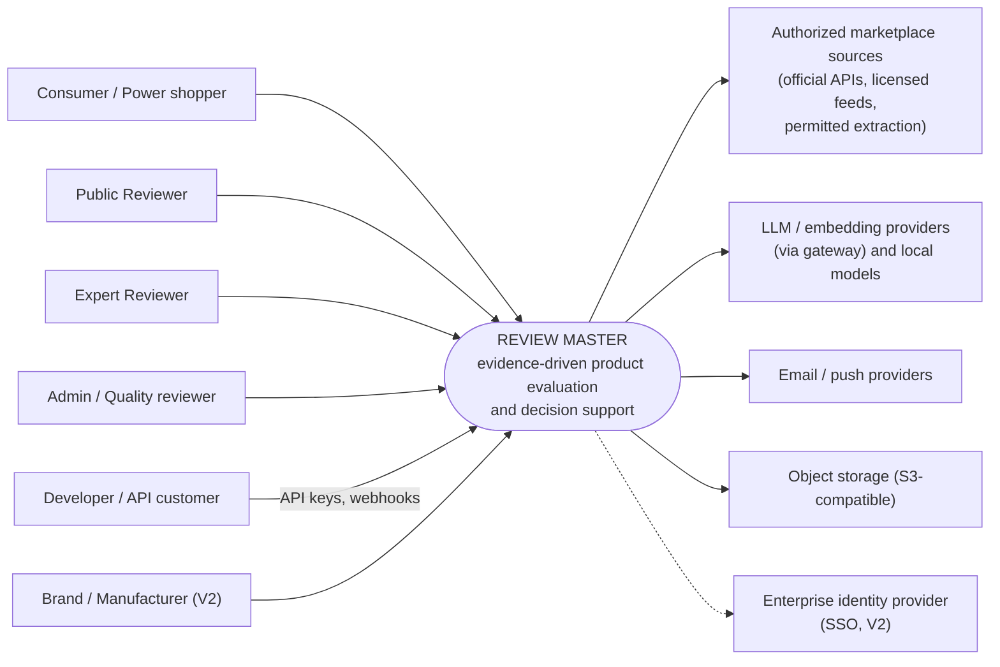
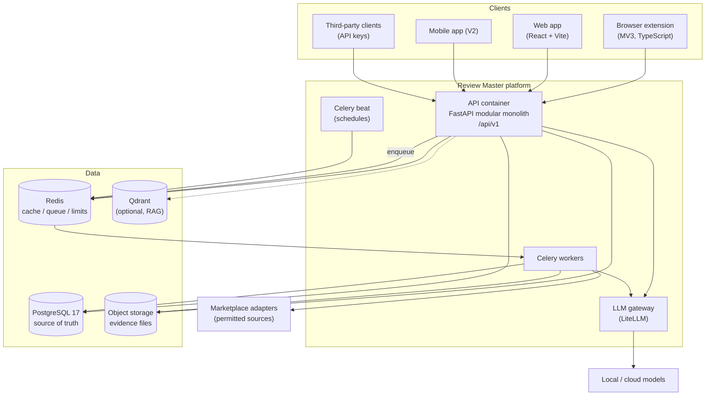
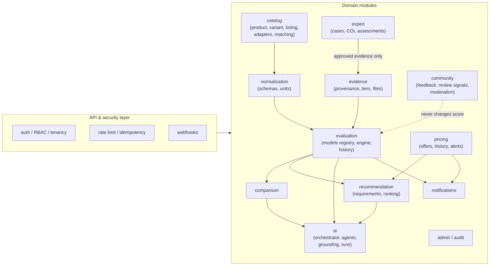
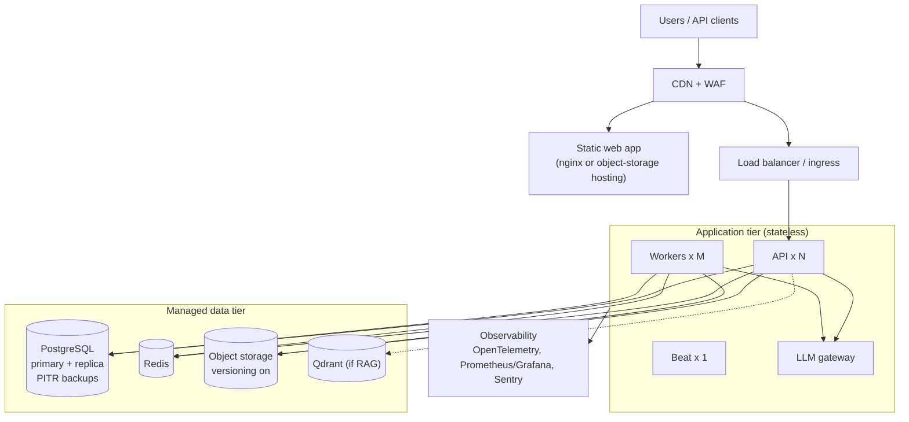

# Architecture Views

Diagrams at four zoom levels (context → container → component → deployment), plus the modular-monolith layout, the future service-extraction path and the observability design. Diagrams use Mermaid (renders on GitHub/GitLab and in most Markdown viewers). A static picture of the whole system is in `diagrams/architecture_overview.png`.

Related: `REVIEW_MASTER_ARCHITECTURE_README.md` (rules and decisions) · `CLIENTS_EVENTS_RELIABILITY.md` · `DATA_MODEL.md`.

---

## 1. Context view (who and what Review Master talks to)



## 2. Container view (deployable units)



## 3. Component view — the backend modular monolith

One deployable, many modules. Each module owns its tables and exposes a Python interface; other modules call that interface, never its tables. This keeps later extraction cheap (§5).



Dependency rules (enforced in CI with an import-linter such as `import-linter`):
- `evaluation` imports `evidence` and `normalization` only. It never imports `community`, `pricing`, `ai` or any marketplace adapter.
- `ai` may read module interfaces but no module imports `ai`, so the platform runs with AI switched off.
- `catalog` adapters live in `catalog/adapters/<marketplace>/` and are loaded through a registry.

### 3.1 Suggested backend package layout

```
backend/app/
├── main.py                 # ASGI app, /healthz, router mounting
├── worker.py               # celery_app
├── core/                   # config, logging, db session, security, errors
├── auth/                   # users, roles, sessions, api keys (AuthProvider interface)
├── catalog/                # models, matching, adapters/<marketplace>/
├── normalization/          # category schemas, unit conversion
├── evidence/               # evidence, trust tiers, uploads
├── evaluation/             # model registry, engine (pure functions), history
├── community/              # feedback, review signals, moderation
├── expert/                 # case state machine, COI
├── recommendation/         # requirements, hard constraints, ranking
├── comparison/
├── pricing/                # offers, price records, alerts
├── user_space/             # saved products, preferences, notification settings
├── notifications/
├── ai/                     # orchestrator, agents/, skills/ (grounding, sanitize, routing), runs
├── admin/                  # audit log, integrations, mappings
├── events/                 # event bus, webhook delivery
└── tools/                  # export_openapi, seed scripts
```

## 4. Deployment view



| Environment | Purpose | Data | Notes |
|---|---|---|---|
| `local` | Developer machine | Synthetic seed | `docker compose up` (see `compose.yml`) |
| `ci` | Pipeline | Ephemeral | Service containers + golden fixtures |
| `staging` | Pre-production | Anonymized/synthetic only | Same images as production; used for pilot rehearsal |
| `production` | Live | Real | Managed Postgres/Redis/object storage; manual approval deploy |

Hosting target (cloud, container runtime) is an open decision (architecture §12 #4). The images are runtime-neutral: ECS/Fargate, Cloud Run, Azure Container Apps, a Docker host, or Kubernetes all work. Do not adopt Kubernetes until measured load or team structure justifies it.

## 5. Modular monolith → services: extraction path

Start as one deployable (capsule §13, §42). Extract a module only when one of these is true: independent scaling, different availability requirement, different deployment cycle, resource isolation, or separate team ownership.

| Likely first extraction | Trigger | What makes it cheap | Interface to keep stable |
|---|---|---|---|
| Marketplace ingestion | Many adapters, rate-limit isolation, crawler resource spikes | Adapters behind `MarketplaceAdapter`, work already runs in Celery | Adapter protocol, `OfferObservation`, `ListingIdentity` |
| Review intelligence | Heavy NLP/LLM batch load | Already a worker job reading `feedback` | `build_review_quality_signals`, `FeedbackSummary` |
| AI service | Different scaling/GPU, separate team | `ai` module imported by nobody; gateway already separate | Orchestrator API, `ai_runs` |
| Notification service | Large fan-out, different SLA | Already event-driven and async | Events (`price.changed`, `evaluation.updated`) |
| Recommendation service | Latency or scale of ranking queries | Pure functions over read models | `Requirements`, ranking result schema |

Migration steps (same for each): (1) module interface becomes an internal HTTP/event contract; (2) module gets its own schema and DB role; (3) other modules stop touching its tables; (4) deploy separately behind the same gateway; (5) move the data. **The evaluation engine is deliberately last:** it is the audit-critical core and its determinism is easier to guarantee in one codebase.

## 6. Observability architecture

| Signal | Tooling | What is captured |
|---|---|---|
| Traces | OpenTelemetry → collector → backend of choice | One trace per request, propagated `trace_id` through API → Celery → LLM gateway |
| Metrics | Prometheus + Grafana | API latency/error rates, queue depth, job duration, cache hit rate, per-adapter freshness, LLM calls/tokens/cost, evaluation latency |
| Logs | Structured JSON, `trace_id` on every line | Application, worker, integration logs |
| Errors | Sentry | Exceptions with release and user-less context |
| Audit | `audit_log`, `ai_runs` (PostgreSQL) | Material changes and AI operations, queryable by `trace_id` |
| Product-quality monitoring | Scheduled SQL/Python reports | Confidence distribution, share of `insufficient_evidence`, user correction rate, identification review-queue size, stale-evidence count |

Alerts (starting set, tune later): API 5xx rate, p95 evaluation latency above target, queue backlog growing, adapter freshness older than threshold, LLM budget breach, failed webhook deliveries, backup job failure.

Evaluation-quality monitoring is a first-class concern from the capsule's NFRs: dashboards must make it obvious when too many products fall into *Limited*/*Insufficient* confidence or when user corrections spike.
