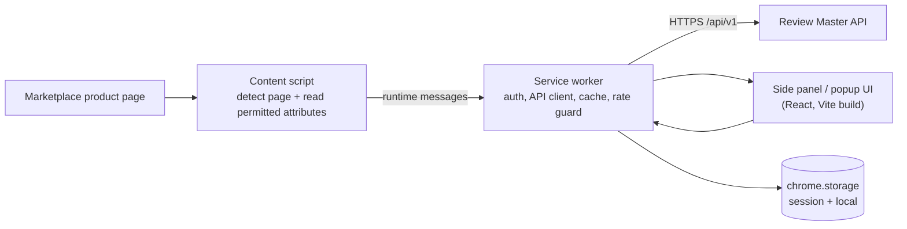

# Clients, Events and Reliability

Covers the browser extension, web app and mobile architectures, the event/webhook design, the asynchronous job catalog, and the failure/retry strategy. Numeric values (timeouts, retry counts, schedules) are **proposed starting values** to be tuned from measurements.

---

## 1. Browser extension architecture (V1)



| Part | Responsibility | Rules |
|---|---|---|
| Content script | Detect a supported product page; extract only the attributes the adapter is permitted to read; send them to the service worker | No cookies, no credentials, no browsing history, no bypass of access controls; runs only on the supported marketplace's host pattern |
| Service worker (MV3) | Holds the API client, attaches the access token, caches recent lookups, enforces client-side backoff | MV3 workers are event-driven and can be stopped at any time: keep no state in memory, persist in `chrome.storage` |
| Side panel / popup | Renders product name and variant, Review Master evaluation, community experience, expert assessment, confidence, offers, alternatives | Renders API output only; never computes a score; shows "not supported" and error states |
| Options page | Login state, notification and privacy settings | Minimum data kept locally |

Authentication: sign in through the web app flow (for example the browser identity API's web-auth flow); the extension keeps a short-lived access token in `chrome.storage.session` and a refresh token only where the browser allows protected storage. Tokens are never exposed to content scripts.

Manifest rules (checked by the CI "permission gate"): minimum `host_permissions` limited to the V1 marketplace and the Review Master API origin; no `cookies`, `history`, `webRequest`/broad `<all_urls>` permission; permissions justified one by one in the store listing.

States the UI must handle (from the capsule's extension test list): supported page, unsupported page, missing data, API failure, ambiguous identity (user picks a variant), unconfirmed match badge.

Page lookup flow: see `SEQUENCE_DIAGRAMS.md` §1.

## 2. Web application architecture (V1)

| Concern | Decision |
|---|---|
| Stack | React + Vite + TypeScript; React Router; TanStack Query for server state; a small state library only for UI state |
| Delivery | Static build served behind nginx or object-storage hosting + CDN. Vite bakes `VITE_*` values at build time, so use one build per environment or a runtime `config.js` |
| Key screens | Product page (three separate sections), Evaluation view with evidence drill-down, Compare view, Recommendation drawer, Universal command/search, Saved items, Price alerts, Notification settings, Admin portal, Expert portal |
| Design rules | Three trust outputs shown separately and never blended; confidence badge next to every score; "not available" instead of zero; AI text labelled; evidence label shows the source type; common actions in ≤3 clicks (SRS target) |
| Accessibility and i18n | WCAG-minded components; strings externalized from day one; currency/number formatting by locale (the capsule's example uses ₹) |
| Auth | Session via API; access token in memory, refresh handled by the API (httpOnly cookie recommended for the web app); role-based route guards (UI hiding is cosmetic, the API is the authority) |
| Error handling | Typed API errors map to user-facing states: `unavailable`, `insufficient_evidence`, `ambiguous_identity`, `forbidden`, `rate_limited` |
| SEO | A pure SPA is weak for public search indexing. If public SEO pages become a goal, add a server-rendered public site later (open decision #8) |

## 3. Mobile architecture (V2)

- Same backend APIs, same scores. The app implements: search, compare, saved products, chatbot, notifications, price alerts.
- **A mobile app cannot inspect other apps' private data.** Designed entry points are: share-sheet product URL, authorized affiliate links, authorized marketplace APIs, user-shared links, and optional receipt upload for purchase verification.
- Push notifications via a push provider; deep links open the product/evaluation screen.
- Framework is an open decision (cross-platform with TypeScript to share types and API client vs. native). Decide at the start of V2; the API contract is the only coupling.

---

## 4. Event and webhook architecture

### 4.1 Event catalog (starting set)

| Event | Emitted when | Typical consumers |
|---|---|---|
| `product.created` / `product.mapping.changed` | Canonical product or mapping changes | Cache invalidation, search index |
| `evidence.created` / `evidence.version.created` | Evidence added or versioned | Evaluation recalculation |
| `product.evaluated` / `evaluation.updated` | New evaluation row inserted | Cache invalidation, notifications, customer webhooks |
| `price.changed` | New price observation passes change rules | Alerts, customer webhooks |
| `feedback.moderated` | Moderator decision | Review analysis, community insights refresh |
| `recommendation.changed` | A user's recommendation result differs | Notifications |
| `expert.case.transitioned` | Expert case changes state | Audit, notifications to expert/admin |
| `integration.error` | Adapter failure or staleness | Admin dashboard, alerts |
| `product.saved` | User saves a product | Alert defaults, analytics |
| `ai.run.completed` | An AI run finishes | Cost metering, audit |

### 4.2 Transactional outbox

Events are written to `ops.event_outbox` **in the same database transaction** as the change that caused them. A dispatcher worker reads the outbox and publishes to internal consumers and webhook deliveries. This gives at-least-once delivery without a message broker for V1 and avoids the "saved but event lost" failure. Consumers must be idempotent (dedupe on `event_id`).

Envelope:

```json
{
  "event_id": "01J...",          // UUIDv7, unique
  "type": "product.evaluated",
  "api_version": "v1",
  "occurred_at": "2026-10-10T08:00:00Z",
  "org_id": "…",
  "trace_id": "…",
  "data": { "variant_id": "…", "evaluation_id": "…", "model_version_id": "…" }
}
```

### 4.3 Customer webhooks

- Registration per organization: URL, event types, secret.
- Signature header: `X-RM-Signature: t=<unix>,v1=<hex HMAC-SHA256 of "t.body">`; receivers reject timestamps older than 5 minutes.
- Retry schedule (proposed): 1 min, 5 min, 30 min, 2 h, 12 h, then mark `failed`, surface to the admin and the customer, allow manual replay.
- Delivery attempts are stored in `webhook_deliveries` (status code, latency, next retry).
- Receivers de-duplicate on `event_id`; payloads follow documented schemas and are versioned with `api_version`.

---

## 5. Asynchronous job catalog

Heavy work never runs in the request path (capsule §34).

| Job | Trigger | Queue | Idempotency key | Retry | Timeout |
|---|---|---|---|---|---|
| Marketplace ingestion / product sync | Schedule, admin action | `ingest` | `adapter + listing_id + window` | 3, exponential backoff | 5 min |
| Price refresh | Schedule per offer priority | `ingest` | `offer_id + observed_at` | 3 | 2 min |
| Evaluation recalculation | `evidence.*`, model publish | `evaluate` | `variant_id + model_version_id + evidence_snapshot_hash` | 3 | 1 min |
| Review analysis (signals, summary) | Schedule per product, new moderated feedback | `analysis` | `variant_id + feedback_watermark` | 2 | 10 min |
| Evidence processing (scan, extract, index) | Upload | `evidence` | `evidence_version_id` | 3 | 10 min |
| Price alert evaluation | `price.changed` | `alerts` | `alert_id + observation_id` | 3 | 30 s |
| Notification delivery | Notification created | `notify` | `notification_id + channel` | 5 | 30 s |
| Webhook delivery | Outbox event | `webhooks` | `delivery_id` | per schedule in §4.3 | 10 s |
| Stale-data monitor | Schedule | `monitor` | date + scope | 1 | 5 min |
| Backup verification | Schedule (weekly) | `monitor` | date | 1 | 30 min |

Separate queues let workers scale and be throttled independently (for example, ingestion cannot starve alerts).

---

## 6. Failure and retry strategy

General rules for every outbound call: explicit timeout; bounded retries with exponential backoff **and jitter**; circuit breaker after repeated failures; idempotency keys on anything that writes; failure is converted into a defined degraded result, never a raw exception to the user.

| Dependency fails | What the user sees | System behavior |
|---|---|---|
| PostgreSQL primary | Maintenance/error page; reads may continue from a replica if configured | Health check fails → load balancer drains; writes blocked; alert; restore/failover per `NON_FUNCTIONAL_REQUIREMENTS.md` |
| Redis | Slower responses (cache miss); rate limiting falls back to a conservative in-process limit | Cache bypassed; Celery enqueue fails fast and is retried via the outbox; alert |
| Object storage | Evidence file unavailable; scores still shown | Evidence metadata is in Postgres; downloads show "temporarily unavailable"; uploads rejected with retry hint |
| LLM gateway / provider | Deterministic template explanation, no chat | Circuit breaker opens; fall back to local model if configured; budget and error alerts |
| Marketplace adapter | Offers marked stale or unavailable; evaluation unaffected | Per-adapter circuit breaker; retry with backoff; `integration.error` event; admin dashboard |
| Qdrant | Chat/explanations answer without retrieved passages and say so | Empty retrieval result with `partial_retrieval: true`; no effect on scoring |
| Email/push provider | Notification delayed; in-app notification still delivered | Retry up to 5 times, then mark `failed` and surface |
| Customer webhook endpoint | None (it's their endpoint) | Retry schedule §4.3, then `failed` + replay |
| Malware scanner | Upload held as `quarantined/pending` | File never reaches storage-ready state until scanned |

Poison messages: tasks that exhaust retries move to a dead-letter queue (a `jobs` table row with `status = dead`) visible in the admin dashboard, with the `trace_id` for investigation.

Deployments: database migrations are backward-compatible for one release (expand → migrate → contract) so API and workers of adjacent versions can run together during rollout.
