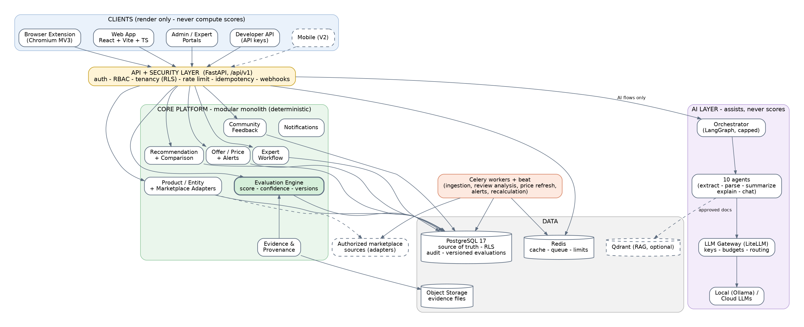

# Review Master — Executive Summary

*One-page overview for the technical lead. Detail lives in the linked documents; start with `00_INDEX.md` for the reading order.*

## What it is

Review Master identifies the exact product a user is looking at, evaluates it with a **versioned, deterministic, category-specific model**, shows the **evidence and confidence** behind every score, and helps users compare products, get recommendations and time a purchase. It is API-first: a browser extension, a web app (and later mobile) and customer integrations all consume the same backend. The long-term vision extends the same engine from products to restaurants, hotels and services.

The product's promise is deliberately narrow and honest:

> Every score shown is either computed by a published model from traceable evidence and shown with a confidence level, or explicitly marked *limited confidence* / *insufficient evidence*, or not shown at all.

## The architecture in five decisions

| # | Decision | Why |
|---|---|---|
| 1 | **Deterministic core, AI at the edges.** The LLM extracts, parses, summarizes and explains; it never produces a score | Reproducible, auditable, injection-resistant. Enforced by a CI determinism gate |
| 2 | **Confidence is first-class and separate from the score.** Missing data is "not scored", never zero | Prevents over-trusting a high score built on thin evidence |
| 3 | **Modular monolith (FastAPI) + workers, not microservices** | Focused V1, small team; extraction path documented for later |
| 4 | **PostgreSQL is the source of truth**, with Redis for cache/queue and S3-compatible storage for evidence | One durable system; row-level security for tenant isolation; append-only audit |
| 5 | **Sellable by design**: multi-tenant, scoped API keys, signed webhooks, usage metering, versioned model registry, entity-ready schema | Commercial API and future domains without redesign |

## Technology at a glance

React + Vite + TypeScript (web, extension) · FastAPI + Pydantic + SQLAlchemy + Alembic · Celery + Redis · PostgreSQL 17 · S3-compatible object storage · LangGraph for AI flows only · LiteLLM gateway (provider keys, budgets) with local Ollama option · Qdrant for RAG (optional) · Neo4j for the V3 context graph (optional) · Keycloak for enterprise SSO (later) · Docker Compose + GitHub Actions CI/CD · OpenTelemetry, Prometheus/Grafana, Sentry.

## Scope by release

| Release | Scope |
|---|---|
| **V1** (controlled MVP) | One marketplace, 3 categories (smartphones, laptops, external SSDs), extension + responsive web, deterministic evaluation with evidence and confidence, community feedback, comparison, recommendations, offers and price alerts, admin tools, versioned API |
| **V2** (active assistant) | Chat with tools, buy/track/wait guidance, more marketplaces, mobile, RAG, purchase verification, brand pilot, commercial API |
| **V3** (universal layer) | Context graph, predictive price/quality, household mode, new domains (restaurants, hotels, services) |

## Plan and effort (rough, ±40%)

- **41 V1 stories** → about **354–562 engineering person-days** with contingency → **≈ 4.4–7 months** with a 5-engineer team; delivery plan assumes 13 sprints to pilot-ready plus a 2-sprint pilot.
- Indicative infrastructure: **≈ $230–1,000/month** for a production pilot (excluding LLM usage and data licensing). Assumptions in `COST_AND_EFFORT_ESTIMATE.md`.

## Where we are

| Area | Status |
|---|---|
| Requirements (capsule, 53 user stories) | Done; stories delivered as Word and Excel |
| Architecture, agents, skills, data model, API skeleton, sequences, security, NFRs, test strategy, plan, ADRs | **Design baseline complete** (this package) |
| Infrastructure definition (compose, CI/CD, Dockerfiles) | Written; **syntax-checked, not yet run** — validate and pin images in Phase 0 |
| Evaluation model content (weights, thresholds) | **Draft only — needs domain experts** |
| Application code | Not started |

## Decisions we need from the lead

1. **V1 marketplace and permitted data sources** (also needs legal review) — the critical-path item.
2. Cloud provider and production runtime.
3. LLM/embedding providers behind the gateway.
4. Expert workflow in V1 or V2.
5. Confirm `value` as a separate price-dependent signal.
6. Team size and who owns domain-expert engagement and evidence acquisition.

Full list with deadlines: `DELIVERY_PLAN.md` §4 and architecture §12.

## Top risks

1. Marketplace terms/data access (could block or reshape V1).
2. Domain experts not available to define the models.
3. Product identification accuracy (a wrong variant makes a correct score misleading).
4. Evidence scarcity: many products will honestly show *Limited confidence* until tier-1 evidence exists.
5. Scope creep from the long-term vision.

Mitigations for each, plus ten more risks: `DELIVERY_PLAN.md` §7.

## Likely questions from a technical lead

| Question | Short answer | Where |
|---|---|---|
| Why not microservices? | Small team, evolving boundaries; documented extraction triggers and path | ADR-0001, ARCHITECTURE_VIEWS §5 |
| How do you stop the LLM hallucinating scores or specs? | It cannot write scores; tool-only data access; grounding validation; template fallback | AGENTS.md, architecture §3.13 |
| How is the score reproducible and auditable? | Pure function + immutable model versions + append-only evaluations + audit log | ADR-0003/0004, SKILLS.md |
| How do you prevent a customer from buying a better score? | No write path to scores for any role or key; disclosures; audit | SECURITY_THREAT_MODEL §2–3 |
| How do you handle tenant isolation? | Application checks plus PostgreSQL RLS with CI isolation tests | ADR-0013, DATA_MODEL §3 |
| What if the marketplace changes or blocks us? | Adapter interface, fixtures, monitoring, official APIs/licensed feeds preferred | architecture §3.4, R1/R8 |
| What does it cost to run? | Infra estimate plus a formula for LLM cost; data licensing may dominate | COST_AND_EFFORT_ESTIMATE |
| What happens when a dependency fails? | Defined degraded behaviour, retries with backoff, circuit breakers, dead-letter visibility | CLIENTS_EVENTS_RELIABILITY §6 |
| How will you know it works? | Golden dataset, reviewed test set, identification accuracy method, KPI baselines | TEST_STRATEGY |
| Is the Docker stack proven? | Not yet run; Phase 0 exit criterion | compose.yml, DELIVERY_PLAN Phase 0 |

## Suggested 10-minute walk-through

1. Problem and promise (1 min) → 2. Overview diagram and the five decisions (3 min) → 3. How a lookup and an evaluation work: `SEQUENCE_DIAGRAMS.md` §1–2 (2 min) → 4. Scope, plan and estimate (2 min) → 5. Open decisions and risks, ask for decisions (2 min).
