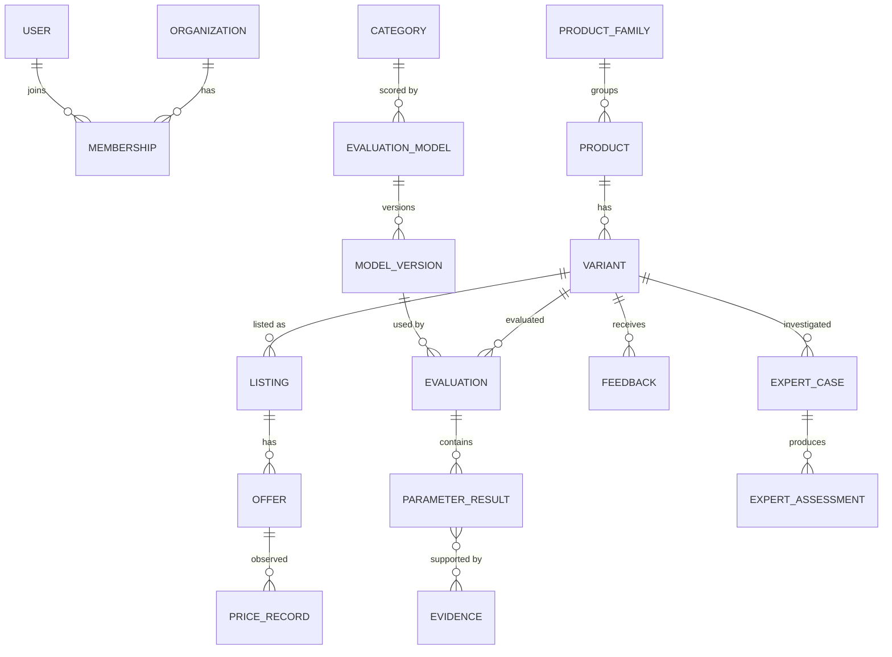

# Review Master — Evidence-Driven Product Evaluation & Decision-Support Platform

**Status:** Architecture Design v1 (baseline)
**Derived from:** Master Project Capsule v1.0 (2026-10-01) and the User Stories set (US-001 to US-053)
**Companion files:** `AGENTS.md` · `SKILLS.md` · `compose.yml` · `.env.example` · `.github/workflows/ci.yml`
**Structure:** follows the AURA architecture document (purpose → flow → components with decision rules → cost budget → technology mapping → principles → limitations). Sections 6–9 and 12 are additions that a sellable multi-tenant product needs: data model, identity/tenancy/API keys, deployment, CI/CD, security, roadmap, open decisions.

---

## 1. System Purpose

Review Master identifies the exact product a user is looking at, normalizes its specifications, evaluates it with a **versioned, deterministic, category-specific model**, shows the evidence and confidence behind the result, and helps the user compare, choose and time a purchase. It is an API-first decision-support platform, not a review aggregator and not an LLM product scorer.

Review Master does **not** claim to know the "true" quality of a product. Its actual guarantee is narrower and more honest:

> Every score shown to a user is either (a) computed by a published, versioned model from traceable evidence and shown with a confidence level, (b) explicitly marked *limited confidence* or *insufficient evidence*, or (c) not shown at all.

Everything else follows from that sentence: the LLM is never the scoring authority, missing data is never zero, and commercial relationships can never change an independent score.

---

## 2. High-Level Flow

### 2.1 System view

```
 Browser Extension ─┐
 Web App (React)  ──┤
 Mobile (V2)      ──┼──►  API + Security Layer  (FastAPI, /api/v1)
 Admin / Expert   ──┤      authn · RBAC · tenancy · rate limit · idempotency
 Developer API    ──┘                │
                                     ▼
              ┌──────────── CORE PLATFORM (modular monolith) ────────────┐
              │  Product/Entity ─ Evaluation ─ Evidence ─ Feedback        │
              │  Expert Workflow ─ Recommendation ─ Comparison            │
              │  Offer/Price ─ Notification ─ Admin ─ AI/Chat             │
              └───────┬──────────────────┬──────────────────┬────────────┘
                      │                  │                  │
                      ▼                  ▼                  ▼
                 PostgreSQL        Redis + Celery     Object Storage
              (source of truth)   (cache, queue,     (evidence files)
                                   schedules)
                                                      Qdrant (RAG, optional)
                      AI flows only ──► Orchestrator (LangGraph) ──► LLM Gateway (LiteLLM)
                                                                      │
                                                          local (Ollama) / cloud providers
```

### 2.2 Decision chain and where AI is (and is not) allowed

```
Identify ─► Normalize ─► Collect evidence ─► Evaluate ─► Explain ─► Compare ─► Personalize ─► Offers/Price ─► Decide
   │            │               │                │           │          │            │               │
 adapter      rules +        provenance      DETERMINISTIC   LLM      engine      engine +         rules
 + rules     units lib      + trust tier     (no LLM)     (grounded) (no LLM)   LLM requirement    (no LLM)
 (+LLM                                                                          extraction only
 assist)
```

| Step | Who decides | LLM role |
|---|---|---|
| Identify / match product | Deterministic matching order + human review for ambiguity | May *propose* attributes; can never confirm a match |
| Normalize specs | Category schema + unit rules | None |
| Evidence trust tier | Set at ingestion from source type | None |
| Evaluate (scores, confidence) | Published evaluation model, pure function | **None, ever** |
| Explain evaluation / comparison / recommendation | LLM, grounded in stored payload | Writes text only; numbers must exist in payload |
| Recommend | Hard-constraint filter, then ranking formula | Extracts requirements from natural language; explains the result |
| Price guidance | Rules over price history | None |
| Expert findings | Human experts, reviewed by admins | None |

---

## 3. Components (with the gaps filled in)

### 3.1 Interface Layer
Five interfaces share one backend: **Browser extension** (V1, Chromium MV3), **responsive web app** (V1), **admin/expert portals** (V1 admin; expert in V1 or V2, see open decisions), **developer API** (V1 core, commercial API V2), **mobile** (V2).

**Rule:** no interface computes a score, ranking or price judgment. The extension and web app render what the API returns. This is what guarantees that US-008's "extension, web, and API show the same score" holds.

Extension security rules (from the capsule): minimum host permissions, no private cookies, no browsing-history collection, no marketplace credentials, no bypass of access controls, only permitted or user-authorized extraction.

### 3.2 API & Security Layer (FastAPI)
- Versioned from day one: `/api/v1/{auth,users,products,categories,evaluations,evidence,feedback,recommendations,comparisons,offers,prices,notifications,chat,experts,admin}`.
- Two credential types: **user sessions** (JWT access + rotating refresh) and **API keys** (see 3.16). Both resolve to the same `Actor` object: `user_id | api_key_id`, `org_id`, `roles`, `scopes`.
- Every request carries `trace_id` (generated at the edge, propagated to Celery tasks, LLM calls and audit rows).
- **Gap filled — idempotency and rate limits.** `POST` endpoints that create records accept an `Idempotency-Key` header (stored 24 h in Redis). Rate limits are token-bucket per `api_key_id`/`user_id`/IP in Redis; limits are plan-dependent for commercial API customers.
- Webhooks: signed `X-RM-Signature: t=<unix>,v1=<hmac_sha256>`; retries with exponential backoff; each event has a unique `event_id` so receivers can de-duplicate.

### 3.3 Orchestrator (LangGraph — AI flows only)
The deterministic platform does **not** go through the Orchestrator. A product-page lookup, a stored comparison or an evaluation fetch are plain service calls. The Orchestrator is used only where an LLM must pick tools or produce text: natural-language requirements, chat, explanations.

State is a typed object, not a loose dict:

```python
class RMState(TypedDict):
    mode: Literal["requirements", "explain", "chat"]
    actor: Actor                          # user/api key, org, roles, scopes
    user_input: str
    requirements: Requirements | None     # validated, see 3.10
    tool_calls: list[ToolCall]            # every call + result reference
    payloads: dict[str, ToolResult]       # tool name -> structured result
    answer: AssembledAnswer | None
    tool_call_count: int
    max_tool_calls: int                   # hard cap, per deployment (default 6)
    llm_iterations: int
    max_llm_iterations: int               # hard cap (default 2)
    cost_usd: float
    cost_ceiling_usd: float               # per request, per deployment
    trace_id: str
```

**Gap filled — termination policy** (mirrors AURA's loop rules):
- `max_tool_calls = 6` and `max_llm_iterations = 2` by default, configured per deployment, never per request, to prevent cost abuse.
- If a tool returns **no data** (product not evaluated, no offers, no feedback), that section is marked `unavailable` and the answer says so. The Orchestrator never asks the LLM to fill the gap. **Absence of data is not a low score and not a reason to loop.**
- A tool failure degrades only its own section (`unavailable: infra_failure`); the rest of the answer still ships.
- Grounding validation (`validate_grounding`) failure triggers one regeneration with stricter instructions, then falls back to a deterministic template explanation.

### 3.4 Product / Entity Intelligence and Marketplace Adapters
Identity hierarchy (capsule §11): `Product Family → Canonical Product → Exact Variant → Marketplace Listing → Seller Offer`. A marketplace listing is never the canonical product, and canonical identity never depends on a URL.

**Adapter interface** — the evaluation engine must never import marketplace-specific code:

```python
class MarketplaceAdapter(Protocol):
    marketplace_id: str
    def identify_listing(self, page: PagePayload) -> ListingIdentity: ...
    def extract_attributes(self, page: PagePayload) -> list[RawAttribute]: ...
    def get_offers(self, listing_id: str) -> list[OfferObservation]: ...  # permitted sources only
    def health(self) -> IntegrationStatus: ...                            # status + freshness
```

Permitted sources only: official APIs, licensed feeds, authorized data providers, permitted page extraction, official product information, authorized partnerships. No private accounts, authentication cookies or restricted data.

**Gap filled — match states and the deterministic matching order.**

| `match_state` | Meaning | Behaviour |
|---|---|---|
| `confirmed` | Verified marketplace-ID mapping, or exact model number + exact configuration | Evaluation shown |
| `probable` | Normalized-attribute similarity ≥ threshold (starting value 0.92) | Evaluation shown with an "unconfirmed match" badge; goes to admin mapping queue |
| `ambiguous` | Two or more candidates | User asked to choose; no evaluation until resolved |
| `unmatched` | No canonical product | No evaluation; user can request one |

Matching order: (1) verified marketplace ID mapping, (2) manufacturer model number / GTIN, (3) generation, (4) exact configuration, (5) normalized attribute similarity, (6) human review. **Attributes extracted by an LLM enter at step 5 with `source = llm` and can never produce `confirmed` on their own.** This is how "LLM never silently merges products" is enforced structurally.

### 3.5 Specification Normalization
Each category has a schema (Smartphone, Laptop, External SSD in V1) defining parameters, units and allowed values. Unit conversion uses a units library (e.g. `pint`) with an explicit table for domain units (MB/s vs GB/s, TB vs GB, mAh vs Wh).

**Rules:** missing is `null`, never `0`; an unrecognized unit is flagged for review, never guessed; every normalized value keeps `source`, `source_type` and `observed_at`.

### 3.6 Evidence & Provenance
Evidence classes (capsule §18) mapped to a trust tier. **The tier is set at ingestion time from source type and is never inferred at query time** (same rule as AURA).

| Tier | Evidence class | Notes |
|---|---|---|
| 1 | Independently tested; expert-tested (approved) | Highest weight in source quality |
| 2 | Manufacturer-published; marketplace-provided; other authorized sources | Labelled as claims, never as tests |
| 3 | Community-reported | Feeds community insights; limited effect on evaluation |

```python
class Evidence(BaseModel):
    evidence_id: UUID
    variant_id: UUID
    parameter: str
    value: Any | None
    source_id: str
    source_type: Literal["independent_test", "expert_test", "manufacturer",
                         "marketplace", "community", "other_authorized"]
    trust_tier: Literal[1, 2, 3]
    observed_at: datetime
    verification_state: Literal["unverified", "verified", "rejected", "withdrawn"]
    methodology: str | None
    document_ref: str | None            # object-storage key
```

Evidence is **versioned and append-only**. Replacing a file creates a new version; nothing is silently overwritten (US-036, capsule §40). Uploaded documents are untrusted input: type/size validation and malware scanning before they reach storage or RAG.

### 3.7 Evaluation Engine (deterministic — the analog of AURA's Evaluator)

**Gap filled — "the engine decides" is not a rule, so here is the aggregation policy.** It is a pure function: same canonical variant + same validated specs + same eligible evidence + same published model version always yields the same output.

Input: `variant`, `validated_specs`, `eligible_evidence`, `evaluation_model_version`.
Output: `parameter_results`, `overall_score | null`, `confidence`, `evidence_refs`, `limitations`, `model_version`.

Decision rules, applied in this fixed order:

1. The category model version must be `published`. Otherwise no evaluation is produced.
2. Variant `match_state` must be `confirmed` or `probable`. Otherwise return an identity prompt, not a score.
3. For each parameter, apply the model's scoring rule (`linear_range`, `piecewise`, `ordinal`, `boolean`) to the best eligible evidence, giving `0–100`. A parameter without evidence that meets the model's evidence requirement is `NOT_SCORED`. **Never `0`.**
4. Evidence conflict on one parameter: higher trust tier wins. Same tier and difference beyond tolerance → mark `conflicted`; use the most recent *verified* evidence if one exists, otherwise `NOT_SCORED`. Never average silently.
5. `overall = Σ(wᵢ · sᵢ) / Σ(wᵢ)` over **scored parameters only** (weights renormalized, same idea as AURA's `renormalize_weights`).
6. `coverage = Σ(wᵢ of scored) / Σ(wᵢ of all)`. If `coverage < 0.40` → confidence is `insufficient_evidence` and the overall score is withheld (`null`); parameter scores are still shown.
7. If any **critical** parameter (flagged in the model) is `NOT_SCORED` → confidence is capped at `limited`.
8. Confidence score:
   `confidence = 0.35·coverage + 0.25·source_quality + 0.15·verification + 0.15·freshness + 0.10·consistency`
   where `source_quality` is the weight-averaged tier factor (tier 1 = 1.0, tier 2 = 0.6, tier 3 = 0.3), `verification` is the share of used evidence with `verified` state, `freshness` is exponential decay per evidence type, and `consistency = 1 − share of conflicted parameters`.
9. Thresholds: `≥ 0.75` → **High confidence**; `0.45 – < 0.75` → **Limited confidence**; `< 0.45` → **Insufficient evidence**.
10. `high` additionally requires that at least `high_confidence_min_tier1_share` of total weight (default 0.30, per category) is backed by tier-1 evidence. Manufacturer claims alone cannot produce High confidence.

**Price is not part of the quality score.** The capsule lists `value` among example parameters but also requires product quality to be separate from price. Resolution proposed here (needs your confirmation, see §12): `value` is a **separate, price-dependent signal** computed at read time from the quality score and the current/median offer price. It is never stored inside an evaluation, because that would make a stored evaluation change whenever prices move.

**Versioning.** Every evaluation row stores `model_version_id` and an `evidence_snapshot_hash`. Published model versions are immutable. Historical evaluations are never updated; a recalculation inserts a new row (US-013).

### 3.8 Feedback Intelligence and Review Analysis
Community feedback is analysed **separately** from the objective evaluation and never changes the deterministic score (US-015).

- **LLM (Feedback Intelligence Agent):** structures and summarizes — sentiment, recurring issues, positives, usage context. Every summary statement must cite `feedback_ids`.
- **Deterministic (skills):** anomaly signals — near-identical text (MinHash/SimHash, Jaccard ≥ 0.85 across ≥ 3 reviews), unusual bursts (daily count z-score > 3 against a 30-day baseline with a minimum count), repeated patterns, inconsistent product references, suspicious clusters.
- **Gap filled — signals, not verdicts.** The output is `review_quality_signals[]` with `signal_type`, `strength` and `evidence_ids` at the **product** level. No "fake probability" is ever computed for a person. Reviewer-level signals exist only in the admin moderation queue. Negativity, writing style and a single unusual review never trigger a signal (US-016).
- Minimum sample size (starting value 10 reviews) before a summary is generated; below it, show raw counts only.

### 3.9 Expert Verification Workflow (human-in-the-loop by design)
State machine (capsule §21):

```
issue_flagged → admin_triage → case_open → expert_assigned → coi_check
   → evidence_requested → testing → assessment_submitted → quality_review
   → approved | rejected | returned → published → (re-evaluation if evidence supports)
```

Enforced in code, not by policy documents:
- Expert may act only on assigned cases. Expert cannot approve their own assessment. A declared or detected conflict blocks assignment.
- Admin cannot set a score or replace a marketplace rating. The only path from an expert case to a score change is: approved assessment → new tier-1 evidence record → re-evaluation through the normal versioned engine.
- Every transition writes an audit row.

This is also Review Master's analog of AURA's human-in-the-loop escape hatch (AURA §3.9).

### 3.10 Recommendation Engine (deterministic ranking, LLM at the edges)
Evaluation answers "how good is this product?". Recommendation answers "which eligible product fits this user?". They are separate modules.

Pipeline: user request → **LLM requirement extraction** → Pydantic schema validation → **hard constraints** → candidate products → evaluation/evidence/confidence → personalized ranking → offer comparison → **LLM explanation**.

```python
class Requirements(BaseModel):
    category: CategoryId
    hard: dict[str, Constraint]      # max_budget_inr, min_capacity_tb, required_compat, required_features
    preferences: dict[str, Level]    # e.g. sustained_write: "high"
    use_case: str | None
    clarifications_needed: list[str] # populated instead of guessing
```

**Gap filled — decision rules.**
1. A product failing any hard constraint is never recommended, whatever its score (US-022).
2. Ranking: `fit = Σ(prefₚ · scoreₚ) / Σ(prefₚ)` over parameters that are scored and relevant to the user; ranked by `fit × confidence_factor` with `confidence_factor` = 1.0 (high), 0.85 (limited), 0.6 (insufficient). The factor is shown to the user, not hidden. Starting heuristic; tune on pilot data.
3. If no product qualifies: say so and offer the single most helpful constraint to relax (`suggest_constraint_relaxation`).
4. The LLM explains the output and never reorders or adds candidates.

### 3.11 Comparison Engine
Same-category comparison on aligned parameters. Cross-category comparison is blocked with an explanation (US-018). Quality, confidence and price stay in separate columns. A product with insufficient evidence is shown as such, never ranked as zero.

### 3.12 Offer & Price Intelligence
Model: `Offer → PriceRecord (observed price, timestamp, source, provenance) → price history`. `price_records` is append-only and partitioned by month.

- **V1:** current offers, simple historical context (min / median / max over 30, 90, 180 days plus data-coverage days), price alerts and target-price alerts. Alerts are evaluated by a Celery task when a new observation arrives, with a 24-hour cooldown per alert to avoid spam (US-027).
- **V2:** rule-based buy / track / wait guidance (current price, history, coverage, urgency, budget, availability, verified sale info).
- **V3:** predictive forecasting.
- Never state a future price as certain without reliable evidence. Stale offers are flagged.
- Keep these as separate concepts in data and UI: `affiliate_click`, `attributed_conversion`, `verified_purchase`. A click is not a purchase.

### 3.13 AI Chat Layer and Tool Architecture
The LLM gets **explicit tools**, never database access:

`search_products · get_product · get_evaluation · compare_products · get_offers · get_price_history · get_feedback · get_expert_assessment · save_product* · create_price_alert*`  (*write tools require explicit user confirmation)

Flow: User → Chat API → Orchestrator → intent/requirements → tool selection → backend tools (each re-checks the actor's permissions) → structured results → `validate_grounding` → Response Assembler → grounded answer.

**Gap filled — grounding check.** Before an answer is returned, every number, product name and parameter in it must be present in the tool payloads of that request. Anything else fails validation. Text coming from marketplaces, reviews or uploaded documents is treated as **untrusted data**, never as instructions (prompt-injection mitigation, `sanitize_untrusted_text`).

### 3.14 RAG (Retrieval — optional in V1, planned V2)
Qdrant indexes only **approved** documents: expert reports, product manuals, approved manufacturer documents, test reports, methodology documents.

```
Upload → malware scan → type/size validation → text extraction → chunk
       → embed (via gateway) → upsert to Qdrant with payload
         {doc_id, org_id, trust_tier, approval_state, product_ids, category}
```

- Retrieval always filters on `approval_state = approved` and on tenant (`org_id`).
- **Gap filled — empty is a valid result.** If nothing passes `min_similarity` (starting value 0.55), return an empty list. Never pad to fill `top_k`.
- Retrieved is not verified: a retrieved chunk carries its `trust_tier`; it is displayed with its source type.
- **RAG never feeds scoring.** It is a retrieval aid for explanations and Q&A.
- Lean alternative: if you want fewer moving parts in V1, `pgvector` inside PostgreSQL can replace Qdrant for small corpora; the retrieval skills hide the store behind one interface.

### 3.15 Notifications
In-app, email, browser push, and later mobile push. Types: price alerts, target-price alerts, evaluation changes, low-confidence alerts, stale-data reminders, review-quality alerts. Delivery is asynchronous (Celery). Users choose types per channel; defaults are conservative; events are throttled or grouped to avoid overload (US-027, US-028).

### 3.16 Identity, Tenancy and API Keys (what makes it sellable)

**Do we need another database for login/sign-up?** Not for V1. A separate user database adds operational cost without benefit. Plan:
- **PostgreSQL `auth` schema** holds `users`, `roles`, `user_roles`, `organizations`, `memberships`, `auth_sessions`, `api_keys`.
- **Redis** holds short-lived items only: rate-limit buckets, OTP/email-verification tokens, idempotency keys, revocation cache.
- **Passwords:** argon2id. **Email verification** required. **Access token:** JWT, 15 minutes. **Refresh token:** rotating, stored hashed in `auth_sessions`, revocable. **MFA** (TOTP) required for Admin and Expert roles.
- **Auth provider interface:** the backend talks to an `AuthProvider` abstraction. V1 implementation is built-in. **Keycloak** (compose profile `enterprise-auth`) is the planned V2 swap-in for SAML/OIDC SSO, social login and enterprise customers, using its own database on the same PostgreSQL server.
- **Tenancy:** every tenant-owned table carries `org_id`, enforced by PostgreSQL **Row-Level Security** (`SET app.current_org` per request) in addition to application checks. A bug in a query then cannot leak another customer's data.
- **Roles:** Consumer, Public Reviewer, Expert Reviewer, Admin, Developer/API Consumer, Brand/Manufacturer (V2). Least privilege, role changes audited, no self-escalation (US-033).
- **Customer API keys:** format `rm_live_<prefix>_<secret>`; only `prefix` and `HMAC-SHA256(secret, server_pepper)` are stored; the secret is shown once; keys carry `scopes`, `org_id`, `expires_at`, `last_used_at`; rotation and revocation are audited.
- **Usage metering:** every API-key call writes a `usage_events` row (async), which enables plan limits now and billing later (a payment provider is an open decision).
- **Commercial separation:** no API role, key scope or tenant plan can write to scores, verdicts or expert findings (US-039).

**API keys for the RAG/LLM system.** Two different things:
1. *Outbound* — keys to LLM and embedding providers. These live only in the **LLM gateway** (LiteLLM) or the secret manager. The backend holds a single gateway virtual key with a budget and rate limit. Switching provider, adding fallbacks or moving to a local model is a gateway config change, not a code change.
2. *Inbound* — keys that customers use to call Review Master (above).

### 3.17 Audit & Memory Storage (PostgreSQL)
`audit_log` is append-only (the application role has `INSERT` but no `UPDATE`/`DELETE`). Each row: actor, action, object, before/after, `trace_id`, timestamp. Covers role changes, model publication, mapping changes, moderation, expert decisions, integration changes, API-key actions. `ai_runs` stores AI operation metadata: inputs/evidence references, model/config, result, confidence, approval state, token and cost counters (US-037).

---

## 4. Cost & Latency Budget

Review Master's deterministic core is cheap by design. LLM cost appears only at the edges: extraction, requirement parsing, feedback summarization, explanations and chat. Latency target from the SRS: **≤ 2 s** for common cached evaluation retrieval.

Mitigations, in priority order:

1. **Cache evaluations** in Redis keyed on `variant_id + model_version_id + evidence_snapshot_hash`; invalidate on `evaluation.created/updated`. This is what makes the 2-second target realistic.
2. **Cache explanations.** An explanation is a function of a stored evaluation, so key it on `evaluation_id + language + prompt_version`. Most page views cost zero LLM calls.
3. **Batch feedback summarization** per product per day in a Celery job (not per page view), with a capped batch size.
4. **Route models** (`route_model`): cheap local model (Ollama) for extraction, classification and requirement parsing; stronger cloud model for chat and long explanations. The routing decision is logged with the result.
5. **Budget per request and per tenant** in the Orchestrator and at the gateway (LiteLLM virtual keys with budgets). On breach, degrade to deterministic template explanations instead of failing.
6. **Do heavy work asynchronously:** marketplace ingestion, product sync, review analysis, evidence processing, price refresh, evaluation recalculation, notification delivery, scheduled monitoring.
7. **Scale measured, not imagined:** API horizontally, workers independently, Postgres indexes/replicas, object storage for evidence. No Kubernetes or Kafka until measured load justifies them.

Track and log per request: LLM calls, tokens, latency, cost, cache hit/miss, `trace_id`.

---

## 5. Technology Mapping

| Layer | Technology | Notes |
|---|---|---|
| Web frontend | **React + Vite + TypeScript** | Same as the reference project. TanStack Query for server state. A pure SPA is weaker for SEO on public product pages; if public SEO becomes a goal, add a server-rendered public site later (see §12) |
| Browser extension | Chromium **Manifest V3**, TypeScript, built with Vite | Content script + service worker + side panel; talks only to the Review Master API |
| Backend API | **FastAPI**, Pydantic v2, SQLAlchemy 2 + Alembic | Async-first; modular monolith with one package per module |
| Background jobs | **Celery** + Redis (worker + beat) | Ingestion, review analysis, price refresh, alerts, recalculation, scheduled monitoring |
| AI orchestration | **LangGraph** | AI flows only (3.3) |
| LLM gateway | **LiteLLM** (compose profile `llm-gateway`) | Provider abstraction, virtual keys, budgets, fallbacks, one OpenAI-compatible endpoint for the backend |
| Local inference | **Ollama** (profile `local-llm`) | Extraction/classification and embeddings without sending data out |
| Cloud LLMs | Any provider behind the gateway | Choice is open (§12) |
| Primary database | **PostgreSQL 17** | Source of truth; extensions `pg_trgm` (search), `pgcrypto`; native partitioning for `price_records`; RLS for tenancy |
| Cache / queue | **Redis 7** | Cache, Celery broker/result, rate limits, idempotency, OTP |
| Vector retrieval | **Qdrant** (profile `rag`) | Same as reference. `pgvector` is the lean alternative for small corpora |
| Knowledge graph | **Neo4j** (profile `graph`) | V3 context graph only. V1 relationships stay in Postgres |
| Object storage | S3-compatible: **SeaweedFS** locally; AWS S3 / Cloudflare R2 / GCS in production | **MinIO is deliberately not used:** its community repository was archived in April 2026 and community Docker images stopped in October 2025 |
| Upload safety | **ClamAV** (profile `scan`) + type/size validation | Uploaded evidence is untrusted |
| Auth | Built-in (argon2id, JWT, TOTP) behind `AuthProvider`; **Keycloak** (profile `enterprise-auth`) later | See 3.16 |
| Email | **Mailpit** locally; managed provider (SES/Resend/etc.) in production | Sign-up verification and alerts |
| Observability | **OpenTelemetry**, **Prometheus** + **Grafana** (profile `observability`), **Sentry** (hosted) | Logs, errors, performance, evaluation-quality metrics, integration health |
| Containers | **Docker** + Docker Compose | Dev and CI; production target decided in §12 |
| CI/CD | **GitHub Actions** (assumption, §12) → GHCR → staging → manual approval → production | See §7 |
| DB admin (dev) | **pgAdmin** (profile `tools`) | Same as reference |
| Time-series (later) | **TimescaleDB** extension | Upgrade path for `price_records` when volume demands it |

---

## 6. Data Architecture

PostgreSQL is the initial source of truth. Primary keys are UUIDv7 (time-ordered). Schemas group tables by module.

| Schema | Core tables |
|---|---|
| `auth` | `users`, `roles`, `user_roles`, `organizations`, `memberships`, `auth_sessions`, `api_keys`, `usage_events` |
| `catalog` | `categories`, `product_families`, `products`, `variants`, `marketplaces`, `listings`, `offers`, `product_mappings` |
| `pricing` | `price_records` (partitioned, append-only), `price_alerts` |
| `evaluation` | `evaluation_models`, `evaluation_model_versions`, `parameters`, `evaluations`, `parameter_results` |
| `evidence` | `evidence`, `evidence_documents`, `evidence_versions` |
| `community` | `feedback`, `review_analysis`, `review_quality_signals`, `moderation_actions` |
| `expert` | `experts`, `expert_cases`, `expert_assignments`, `expert_assessments`, `coi_declarations` |
| `user_space` | `user_preferences`, `saved_products`, `comparisons`, `recommendations`, `notifications`, `notification_settings` |
| `ops` | `ai_runs`, `audit_log`, `integrations`, `webhooks`, `webhook_deliveries`, `jobs` |



Data rules:
- `evaluations`, `evidence_versions`, `price_records`, `audit_log` are append-only. Published `evaluation_model_versions` are immutable.
- Tenant-owned tables carry `org_id` and RLS policies (3.16).
- `entity_id` is reserved on `products` from day one so the Product → Entity generalization (restaurants, hotels, services) needs configuration, not a redesign.
- PostgreSQL full-text + `pg_trgm` serves V1 search; a dedicated search engine only when measured need appears.

---

## 7. Deployment, Docker and CI/CD

### 7.1 Containers (see `compose.yml`)

| Service | Purpose | Profile |
|---|---|---|
| `postgres` | Source of truth | default |
| `redis` | Cache, broker, rate limits | default |
| `migrate` | One-shot `alembic upgrade head`; backend waits for it | default |
| `backend` | FastAPI API | default |
| `worker`, `beat` | Celery workers and scheduler | default |
| `objectstore` | S3-compatible evidence storage (SeaweedFS, dev) | default |
| `mailpit` | Catches sign-up and alert emails in dev | default |
| `frontend` | React + Vite dev server | default |
| `qdrant` | RAG vector store | `rag` |
| `ollama` | Local LLM and embeddings | `local-llm` |
| `litellm` | LLM gateway | `llm-gateway` |
| `keycloak` | Enterprise SSO | `enterprise-auth` |
| `neo4j` | V3 context graph | `graph` |
| `clamav` | Upload malware scanning | `scan` |
| `prometheus`, `grafana` | Metrics and dashboards | `observability` |
| `pgadmin` | Database inspection | `tools` |

Run the core stack: `docker compose up -d`. Add features with profiles, e.g. `docker compose --profile rag --profile local-llm up -d`. The compose file is a **development and CI** definition; production uses managed PostgreSQL, Redis and object storage with the same images for backend, worker and frontend.

### 7.2 CI/CD pipeline (see `.github/workflows/ci.yml`)

```
push / PR
  ├─ lint & types ........ ruff, mypy, eslint, tsc
  ├─ backend tests ....... pytest with real PostgreSQL + Redis service containers
  │     └─ golden evaluation tests: fixed inputs → fixed scores (determinism gate)
  ├─ frontend tests ...... vitest + production build
  ├─ extension build ..... MV3 bundle + manifest permission check
  ├─ security ............ gitleaks, pip-audit, npm audit, Trivy
  ├─ API contract ........ OpenAPI schema validation
  └─ docker build ........ backend + frontend images
main only
  ├─ push images to GHCR (tagged with commit SHA)
  ├─ compose smoke test .. start stack, wait healthy, hit /healthz
  ├─ deploy to staging ... pull images, migrate, restart
  └─ deploy to production  (manual approval via protected environment)
```

Required quality gates:
- **Determinism gate:** golden evaluation fixtures must produce byte-identical results; a changed score without a new model version fails the build.
- **Permission gate:** the extension manifest must not request host permissions beyond the supported marketplace list.
- **Migration gate:** `alembic upgrade head` on an empty database and on the previous release's schema.

Secrets live in the CI secret store and the production secret manager, never in the repository. Pin base images and GitHub Actions to digests/commit SHAs before the first production release.

---

## 8. Security and Compliance

- RBAC with least privilege; PostgreSQL RLS for tenant isolation; permission scopes on API keys.
- Encrypted transport everywhere; secrets in a secret manager; webhook signing; API authentication; rate limiting.
- Private evidence is served only through short-lived signed URLs after a permission check.
- Uploaded files are untrusted: size/type validation, malware scan, no server-side execution, stored under random keys.
- Admin logging and immutable audit trails; retention and deletion controls; user data export and deletion endpoints.
- Extension: minimum host permissions, no cookies, no history, no credentials.
- LLM safety: tool-only data access, untrusted-text sanitization, grounding validation, per-request budget.
- Test targets (capsule §44): unauthorized access, role escalation, private evidence access, expert self-approval, malicious uploads.
- Privacy law and marketplace terms of service affect what can be extracted and stored. This document is not legal advice; get legal review for the V1 marketplace before building its adapter.

---

## 9. Roadmap Alignment

| Capability | V1 (controlled MVP) | V2 (active assistant) | V3 (universal layer) |
|---|---|---|---|
| Marketplaces / categories | 1 marketplace, 3–5 categories | More authorized marketplaces and categories | Cross-platform discovery |
| Evaluation | Deterministic, confidence, evidence, history | Richer expert workflow | Quality-change and confidence-change detection |
| AI | Extraction, requirements, summaries, explanations | Chat with tools, voice/text requirements, RAG | Context graph, preference learning with controls |
| Price | Offers, history, alerts | Buy/track/wait guidance | Predictive forecasting |
| Interfaces | Extension, responsive web, admin | Mobile, brand pilot, commercial API | Household/multi-user, advanced API framework |
| Infra additions | Core compose stack, CI/CD | `rag`, `llm-gateway`, `enterprise-auth`, `observability` | `graph`, TimescaleDB if needed |
| Domains | Products | Brand/manufacturer tools | Restaurants, food, places, hotels, services via new evaluation models |

**Story coverage by component** (IDs from the user stories set):
Extension US-001 · Identity US-002–004 · Search/product page US-005–006 · Saved items US-007 · Evaluation US-008–013 · Community US-014–017 · Compare US-018–020 · Recommendation US-021–024 · Offers/price/alerts US-025–028 · Expert US-029–032 · Admin/governance US-033–039 · API/webhooks US-040–041 · V2 US-042–049 · V3 US-050–053.

---

## 10. Key Design Principles (revised)

- **Deterministic core, AI at the edges.** The LLM extracts, classifies, summarizes and explains. It never creates specs, scores, evidence, prices, availability or expert findings.
- **Evidence grounding with confidence.** Every score carries a confidence level and its evidence references; every evidence item carries a source type and trust tier fixed at ingestion.
- **Separation of signals.** Quality ≠ price ≠ affiliate revenue ≠ community sentiment ≠ expert assessment ≠ personal recommendation. A recommendation may combine them, but each keeps its meaning.
- **Canonical identity.** A listing is not a product; an LLM never silently merges products.
- **Versioned and auditable.** Evaluation models, evaluations and evidence are versioned; history is never overwritten; every material change is audited.
- **Bounded AI.** Hard caps on tool calls and iterations; `unavailable` is a legitimate answer, not something to loop on.
- **Adapters, not special cases.** Marketplaces and (later) domains plug in through interfaces; the engine never imports marketplace code.
- **Honest coverage.** The system shows what it could not evaluate as visibly as what it did.
- **V1 focused, architecture extensible.** Build one marketplace and a few categories well; keep `entity_id`, model registry and adapters ready for expansion.

---

## 11. Known Limitations (stated explicitly)

- **Evaluation quality is bounded by evidence.** In V1 most evidence will be tier 2 (manufacturer/marketplace), so many products will honestly show *Limited confidence* until expert or independent test evidence exists. That is correct behaviour, but it affects how the product feels.
- **Weights and thresholds are heuristic starting points** (confidence formula, 0.40 coverage floor, 0.75/0.45 bands, ranking factors, similarity thresholds). The capsule itself says example parameters and weights are not final. They must be validated with a manually reviewed test set and domain experts before publication.
- **Product identity is the highest-risk component.** A wrong variant makes a correct evaluation misleading. Identification accuracy is a tracked KPI; do not claim a number before a baseline exists.
- **LLM extraction and summaries carry their own error rate.** Grounding validation and fallbacks reduce it but do not make it provably correct.
- **Price history depends on permitted data coverage.** New products and sparse data produce weak context; the UI must show coverage.
- **Experts are a human bottleneck.** Cold start with no experts means few tier-1 evidence items; paid testing and admin-run cases are slow.
- **Extension limits.** Marketplace page layouts change; adapters need maintenance. Mobile apps cannot read other apps' private data (affiliate links, authorized APIs, user-shared URLs and optional receipts are the designed alternatives).
- **Legal and licensing exposure** around data extraction, review content and brand relationships is outside this document.

---

## 12. Open Decisions (need your confirmation)

| # | Decision | Default assumed here |
|---|---|---|
| 1 | V1 marketplace (affects adapter, legal review, offer data) | Not chosen |
| 2 | Is `value` a separate price-dependent signal (3.7)? | Yes, separate |
| 3 | Expert workflow in V1 or V2? | Designed now; build timing open |
| 4 | Cloud and production runtime (AWS/Azure/GCP, ECS/Cloud Run/VM, later Kubernetes) | Not chosen; Docker images work on all |
| 5 | LLM and embedding providers behind the gateway | Local Ollama for dev; cloud provider TBD |
| 6 | CI/CD platform | GitHub Actions assumed |
| 7 | Billing/payments provider for the commercial API | Not chosen |
| 8 | Public SEO-driven product pages (would add a server-rendered site) | Not in V1 |
| 9 | Data residency and privacy regime for target markets | Not stated |
| 10 | `high_confidence_min_tier1_share` default (0.30) | Needs calibration |

---

## 13. Related Documents

Reading order and a coverage check against the capsule's expected outputs: `00_INDEX.md`. Views and flows: `ARCHITECTURE_VIEWS.md`, `SEQUENCE_DIAGRAMS.md`, `CLIENTS_EVENTS_RELIABILITY.md`. Data and API: `DATA_MODEL.md`, `api/openapi.yaml`. Models: `EVALUATION_MODEL_SPECS.md`. Quality and security: `NON_FUNCTIONAL_REQUIREMENTS.md`, `TEST_STRATEGY.md`, `SECURITY_THREAT_MODEL.md`. Plan: `COST_AND_EFFORT_ESTIMATE.md`, `DELIVERY_PLAN.md`. Decisions: `adr/`.
