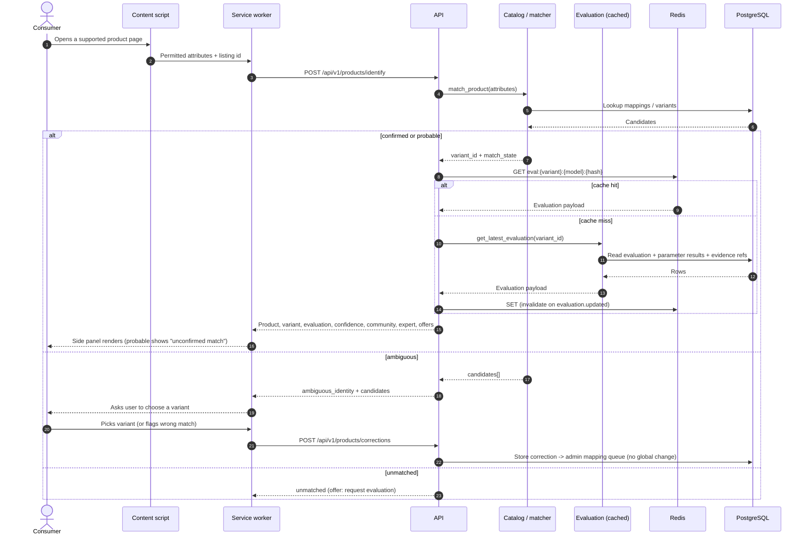
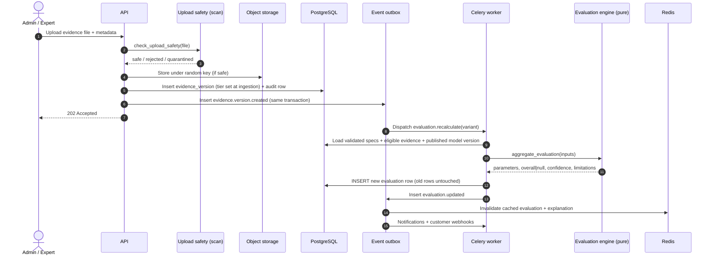
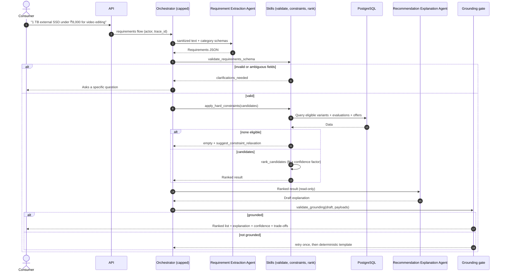
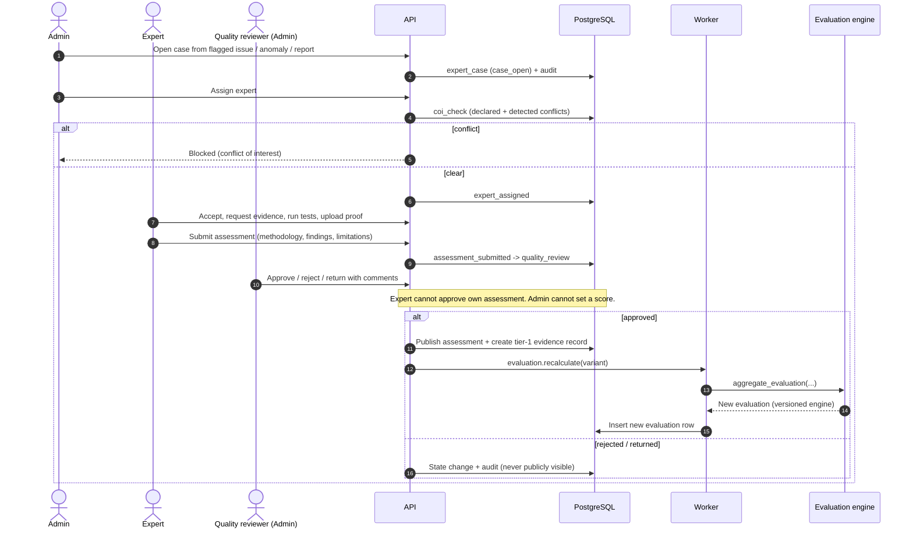
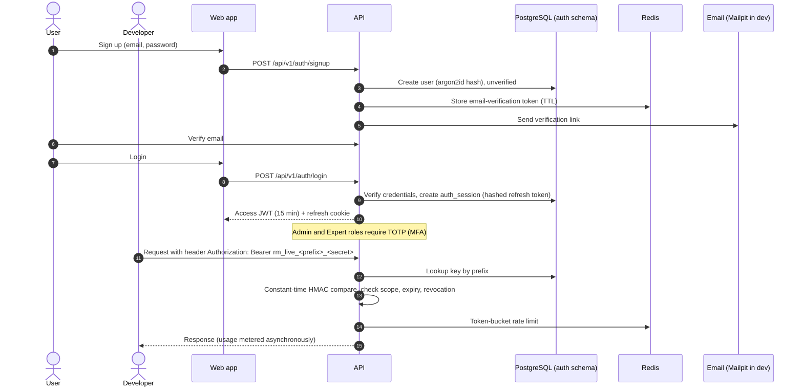
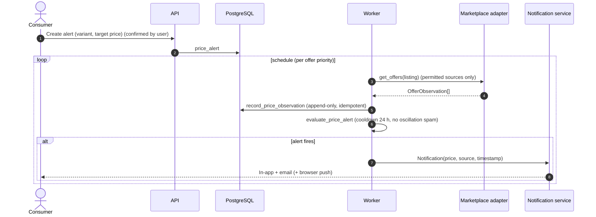

# Sequence Diagrams — Key Flows

Mermaid sequence diagrams for the six flows a reviewer is most likely to ask about. Story IDs refer to `requirements/Review_Master_User_Stories.xlsx`.

---

## 1. Product page lookup from the extension (US-001, US-002, US-006, US-008, US-009)

## 2. Evidence added → evaluation recalculated (US-008, US-010, US-011, US-013, US-036)

## 3. Natural-language recommendation (US-021, US-022, US-023)

## 4. Expert investigation → published assessment → re-evaluation (US-029 to US-032)

## 5. Sign-up, login and API-key access (US-033, US-040)

## 6. Price alert (US-025, US-027, US-028)

